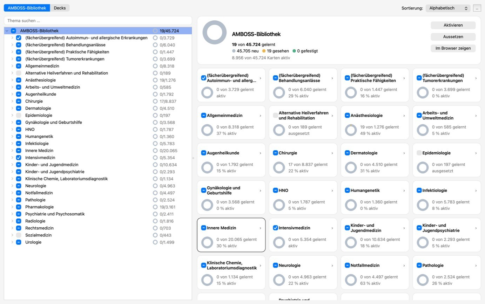
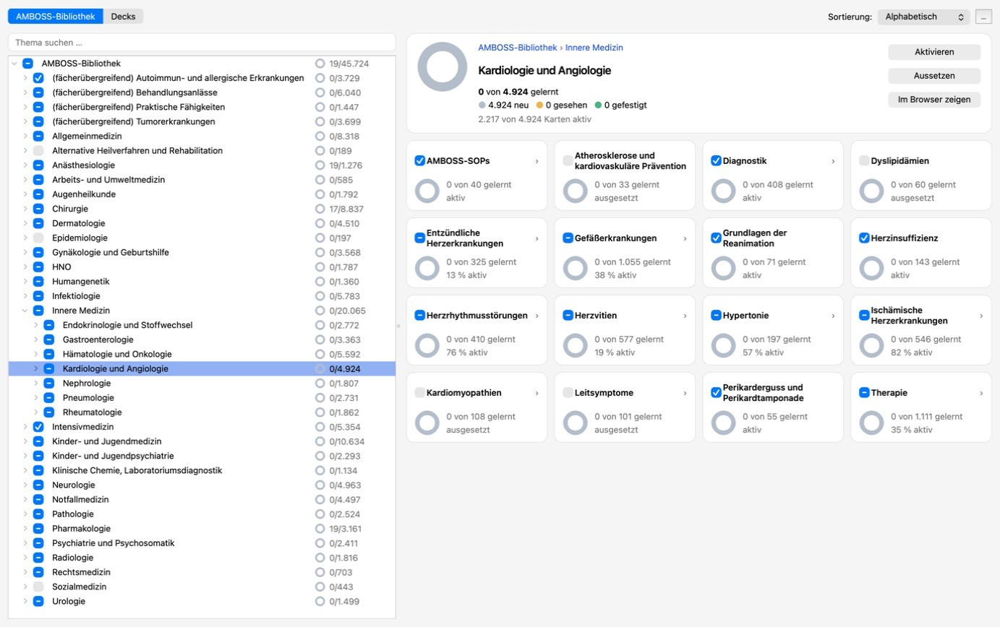
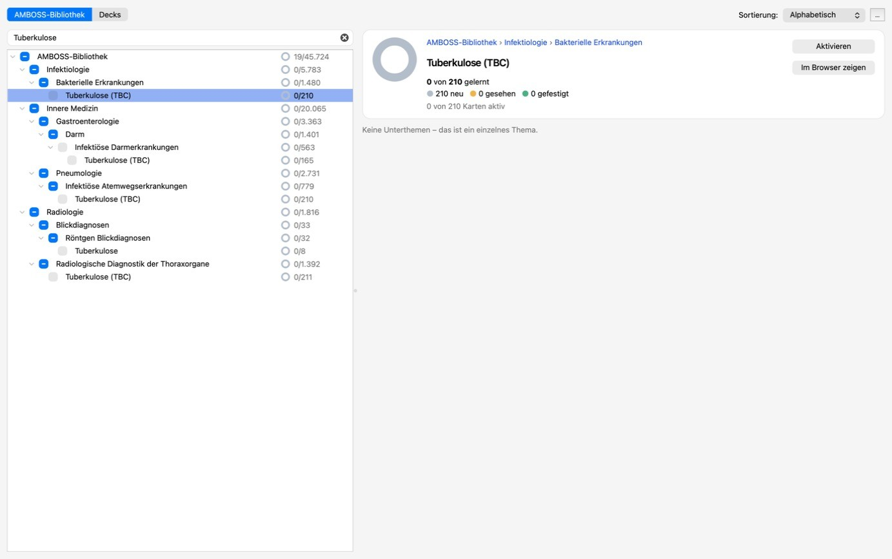
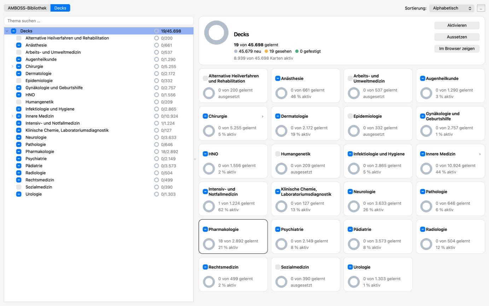
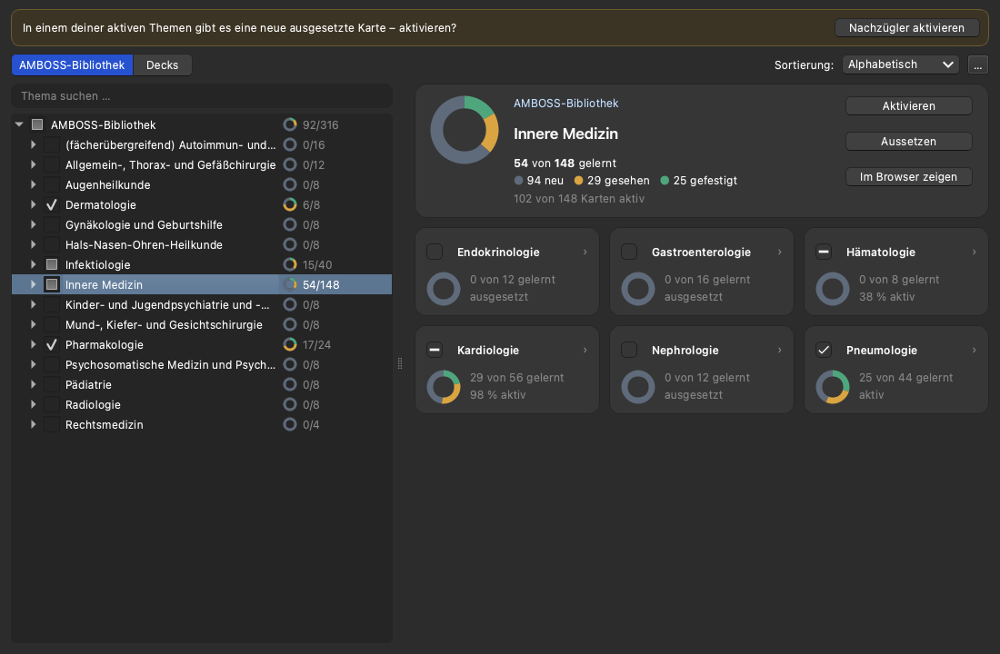

# AnKIzin Explorer

Ein Anki-Addon, das das [AnKIzin](https://ankizin.de)-Deck übersichtlich nach Themen
schaltbar macht: AMBOSS-Bibliotheksstruktur als Baum, Lernstand pro Thema, ein Klick zum
Aktivieren oder Aussetzen – statt sich durch den Tag-Explorer zu klicken.

> **Vibecoded.** Dieses Addon wurde vollständig mit KI (Claude Code) geschrieben: Design im
> Gespräch erarbeitet, Code, Tests und Doku von der KI erzeugt, vom Owner im Alltag getestet.
> Es gibt keine Gewähr – vor dem ersten Schalten lohnt ein Backup (Anki legt ohnehin
> automatisch welche an, und jeder Schaltvorgang lässt sich mit Ctrl/Cmd+Z zurücknehmen).

> Status: v1. Design siehe [docs/SPEC.md](docs/SPEC.md), Umsetzungsentscheidungen in
> [docs/DECISIONS.md](docs/DECISIONS.md).

## So sieht es aus



<table>
<tr>
<td></td>
<td></td>
</tr>
<tr>
<td align="center">Ein Fach mit allen Unterthemen</td>
<td align="center">Suche – Treffer an allen Stellen im Baum</td>
</tr>
<tr>
<td></td>
<td></td>
</tr>
<tr>
<td align="center">Ansicht nach Deck-Struktur</td>
<td align="center">Dunkelmodus (Beispieldaten)</td>
</tr>
</table>

## Installation

- **AnkiWeb:** Code folgt, sobald das Add-on dort veröffentlicht ist.
- **Datei:** `ankizin_explorer.ankiaddon` aus den
  [Releases](https://github.com/Lujosu/ankizin-explorer/releases) herunterladen und
  doppelklicken (oder in Anki *Extras → Add-ons → Aus Datei installieren*). Danach Anki neu
  starten.
- Voraussetzung: Anki 25.02 oder neuer und das AnKIzin-Deck (z. B. über AnkiCollab).

## Funktionen (v1)

- Baum nach AMBOSS-Bibliothek (Standard) oder nach Deck-Struktur
- Live-Suche über alle Themen; Artikel, die an mehreren Stellen hängen, erscheinen überall
- Pro Thema: Ring mit Lernstand (neu / gesehen / gefestigt) und Kartenzahlen
- Übersicht eines Themas mit allen Unterblöcken als Kacheln
- Aktivieren/Aussetzen ganzer Themen, Rückgängig mit Ctrl/Cmd+Z
- Aussetzen eines Oberthemas setzt alles darunter aus (optional „an gewinnt“: Karten, die
  auch in einem anderen aktiven Thema liegen, bleiben aktiv – Option `an_gewinnt`)
- Sicherheitsabfrage ab 500 Karten mit Schätzung, wie viele Tage die neuen Karten bei deinem
  Tageslimit brauchen
- Hinweis auf neue ausgesetzte Karten in aktiven Themen nach AnKIzin-Updates
- Funktioniert in normalem Anki; mit [Onigiri](https://ankiweb.net/shared/info/1011095603)
  zusätzlich als Eintrag in dessen Seitenleiste

## Benutzung

- **Extras → AnKIzin Explorer** (Kürzel Ctrl+Alt+A, am Mac ⌘⌥A), der Link **AnKIzin** in
  der oberen Leiste oder der Knopf **„AnKIzin Explorer öffnen“** unter der Deckliste.
- Checkbox im Baum oder in einer Kachel, oder Knopf im Kopf der Übersicht: ☐/◐ →
  aktivieren, ☑ → aussetzen. Ein Oberthema schaltet seinen ganzen Teilbaum; die oberste
  Zeile im Baum („AMBOSS-Bibliothek“ bzw. „Decks“) schaltet alles. Bei ◐ gibt es im Kopf und
  im Rechtsklick-Menü zusätzlich „Aussetzen“. Klick auf den Rest einer Kachel öffnet das Thema.
- Lernstand: „gelernt“ = gesehen + gefestigt; die Farben des Rings erklärt die Legende im Kopf.
- Aussetzen behält den Lernstand; Deck-Optionen werden nie verändert, das Tageslimit für neue
  Karten regelt weiter Anki.
- Rechtsklick auf ein Thema: „Im Browser zeigen“.
- Im „…“-Menü oben rechts: „Vorklinik anzeigen“ (auch unter *Extras → Add-ons →
  AnKIzin Explorer → Konfiguration*) und „Neu laden“ (Ctrl+R, am Mac ⌘R).

### Mit Onigiri

Externe Einträge sind in Onigiri zunächst archiviert und müssen einmal in Onigiris
Einstellungen aktiviert werden:

- **Seitenleiste:** beim Seitenleisten-Layout den Eintrag **„AnKIzin Explorer“** (mit
  Baum-Symbol) aus den archivierten Einträgen holen. Onigiri übernimmt außerdem den
  Toolbar-Link „AnKIzin“ als eigenen Eintrag – beide öffnen dasselbe Fenster, einer reicht.
- **Startseite:** Der Knopf unter der Deckliste erscheint in Onigiri als externes Widget
  und lässt sich dort im Widget-Layout platzieren.

## Entwicklung

- `ankizin_explorer/` ist das Addon-Paket (Datenlogik ohne Qt in `model`, `build`, `logic`,
  `text`, `loader`; Oberfläche in `ui/`; Anki-Einbindung in `integration.py`).
- Tests der Datenlogik (ohne Anki):

  ```bash
  python3 -m pytest tests
  ```

- Zusätzlich gegen Ankis Backend und Qt (offscreen), mit den Paketen einer Anki-Installation
  und passender Python-Version (Anki 26.x: Python 3.13):

  ```bash
  QT_QPA_PLATFORM=offscreen PYTHONPATH=/Applications/Anki.app/Contents/Resources/app_packages python3.13 -m pytest tests
  ```

- Paket bauen (`dist/ankizin_explorer.ankiaddon`):

  ```bash
  python3 scripts/build.py
  ```

## Lizenz

[GNU AGPL-3.0](LICENSE): Der Code darf frei genutzt, verändert und weitergegeben werden;
Weitergaben und Änderungen müssen ebenfalls offen unter der AGPL-3.0 stehen. AnkiWeb setzt
für Add-ons eine AGPL-3.0-kompatible Lizenz voraus.
